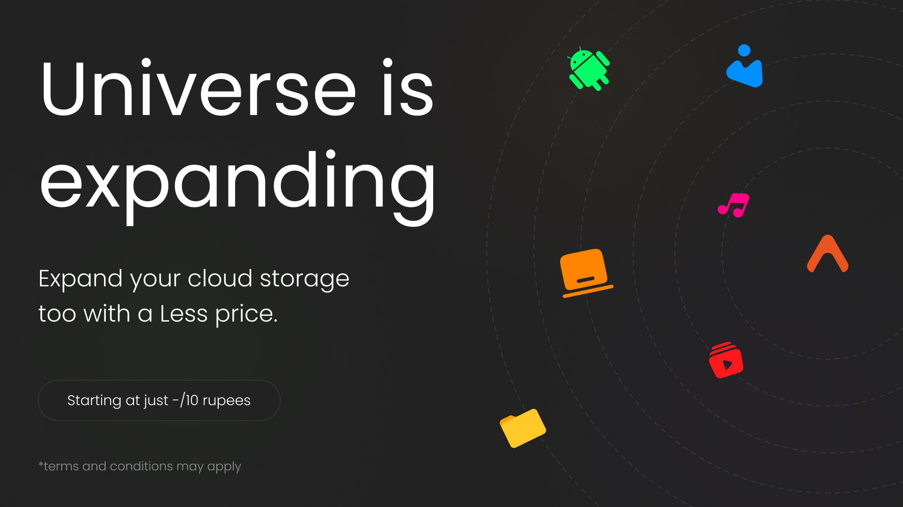
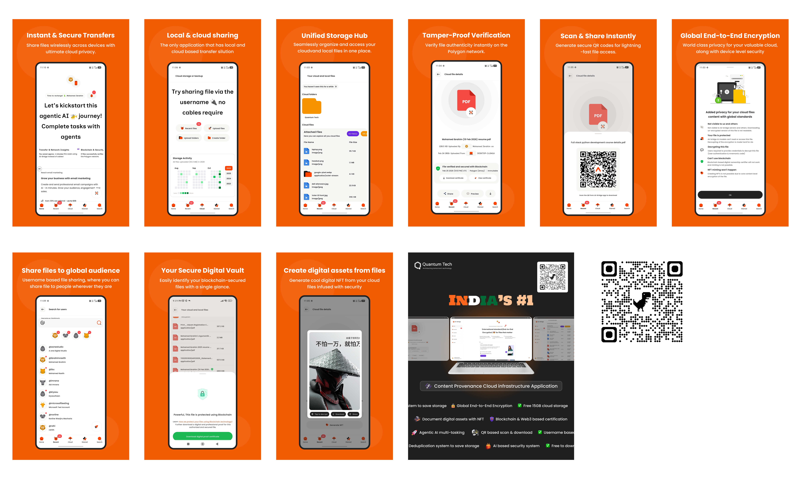

<!-- You can replace the src link with the actual path to your branding image or an animated GIF -->

 
 

# 🌌 AirBridge
**The Ultimate Cross-Platform Ecosystem for File Sharing, Cloud Vault, and AI Intelligence**

*AirBridge is a next-generation ecosystem that breaks the boundaries between devices. Experience zero-latency file transfers, an intelligent cloud vault, blockchain-verified ownership, and a self-learning AI that lets you talk directly to your files. Welcome to the future of data mobility.*

---

## 🚀 Next-Gen Features

AirBridge leverages a powerful suite of modern technologies to completely rethink how we handle digital files. Built for scale, speed, and uncompromising security.

### ⚡ **Instant & Intelligent Transfer**
- **Seamless Local Discovery:** Instant file transfer up to **250 MB** to nearby devices using advanced IP-based device discovery. No internet required for local peer-to-peer sharing.
- **Blazing Fast Uploads:** Powered by Python metadata analysis, our system instantly detects if a file already exists on the cloud. This deduplication bypasses redundant uploads, drastically reducing cloud storage costs and delivering an instant upload experience.

### ☁️ **Unified Storage Hub & Security**
- **Generous Cloud Vault:** Enjoy **15 GB of free cloud storage** for every registered user, with affordable, premium storage options for power users.
- **Scan & Share Instantly:** Easily share and download cloud files from nearby users via QR code scanning. Every file gets its own unique, highly secure QR code.
- **Military-Grade Encryption:** Optional and entirely free **End-to-End Encryption (E2EE)**. We utilize an advanced, high-level secure system built with Python to guarantee your data remains strictly yours.

### 🛡️ **Immutable Ownership**
- **Blockchain Authority:** True file authority and ownership. We provide immutable ownership of files to users via advanced blockchain hashing mechanisms.

### 🤖 **Artificial Intelligence Integration**
- **Smart Document Classification:** An AI-based document classification system that automatically organizes, categorizes, and tags your uploaded files.
- **Chat With Your Files (RAG System):** A revolutionary Smart File Answering system. Using Retrieval-Augmented Generation (RAG), you can ask contextual questions and get smart, accurate answers directly from the contents of the documents you've uploaded.

 

<!-- You can replace the src link with the actual path to your store listing images -->

 

---

## 💡 Use Cases

AirBridge is designed to empower individuals, enterprises, and innovators:

- 🏢 **Enterprise & Office Teams:** Securely transfer confidential corporate files via E2EE and verify authenticity using blockchain before distribution.
- 🎓 **Researchers & Students:** "Talk" to research papers or large PDF documents using our RAG-based AI to instantly extract key findings and answers.
- 🎨 **Content Creators:** Transfer large media files (up to 250MB) seamlessly across mobile, web, and desktop devices without any compression or quality loss.
- 🔒 **Privacy Advocates:** Store data in a secure digital vault with zero-knowledge encryption and blockchain-backed integrity.
- 💻 **Tech Enthusiasts:** Utilize a robust, AI-augmented cloud ecosystem that bridges the gap between local offline speed and cloud convenience.

---

## 🛠 Advanced Tech Stack

AirBridge is engineered using industry-leading technologies to ensure blazing performance, ultimate security, and smart AI capabilities.

| Layer            | Tech Used                                                 |
|------------------|----------------------------------------------------------- |
| Frontend (UI)    | 🖥 Flutter (All platform)                                  |
| Backend (API)    | ⚙️ Node.js + Express.js                                   |
| Backend (AI)     | 🐍 Python Microservice                                    |
| Database         | 📚 MongoDB                                                |
| Cloud Storage    | ☁️ Backblaze B2                                           |
| Deployment       | 🚀 Hostinger VPS + 🍹 Coolify +  🗃️ Render + Github Pages|
| Txt Summarization| 🗨️ Gemini 27B & Groq                                      |
| Containerization | 📦 Docker                                                 |
| Reverse proxy    | ⚙️ NGINX                                                  |
| Blockchain       | ⛓️‍💥 Polygon Testnet                                        |
| E2EE             | 🔐 Python crypto                                          |
| Sentinel security| 🛡️ Gemma 2b on-device AI                                  |
| Smart Chat       | 🗨️ Gemini 120b & Groq                                     |
| Version control  | 🚦 Git + GitHub                                           |
| UI/UX design     | 🎨 Figma + Driblle + Behance + Pinterest                  |
| AI Code Assistant| 🧠 Jules + Google Gemini + AntiGravity + Cluade + Perplexity|
| Orchestration    | ⚙️ Kubernetes + Docker + NGINX                            |
| Caching          | 💾 Redis + MongoDB                                        |
| Logs explorer    | 🔍 Google Cloud Console                                   |

---

## 📄 License

**Proprietary and Confidential**

All rights reserved. This software is the proprietary and confidential property of the author. 

Unauthorized copying, distribution, modification, reproduction, or use of this software, in whole or in part, via any medium is strictly prohibited without explicit written permission. This project is intended for commercial use, is not open-source, and is protected by applicable copyright laws.

The software is covered by an End User License Agreement (EULA) strictly tailored for commercial, proprietary use, overriding any default open-source assumptions.
